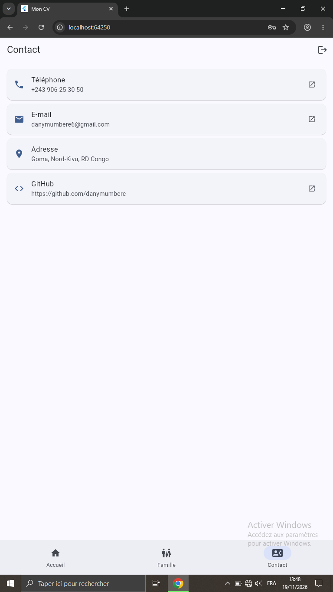

# cv_flutter_dany

Application mobile Flutter présentant mon CV, ma famille et mes coordonnées.

## Fonctionnalités
- **Connexion** : identifiant + mot de passe masqué (identifiants de démo : `admin` / `1234`)
- **Accueil** : CV complet (photo, profil, formation, expériences, compétences, langues, centres d'intérêt)
- **Famille** : liste des membres (nom, photo, lien de parenté, profession)
- **Contact** : téléphone, e-mail, adresse, LinkedIn, GitHub (cliquables via `url_launcher`)
- Navigation par `NavigationBar` (barre du bas)

## Captures d'écran

| Connexion | Accueil (CV) |
|:--:|:--:|
|  |  & (screenshots/02b_accueil.png) |

| Famille | Contact |
|:--:|:--:|
|  |  |

## Lancer le projet
```bash
git clone https://github.com/danymumbere/cv_flutter_dany.git
cd cv_flutter_dany
flutter pub get
flutter run
```

## Technologies
Flutter, Dart, url_launcher, Material 3.
