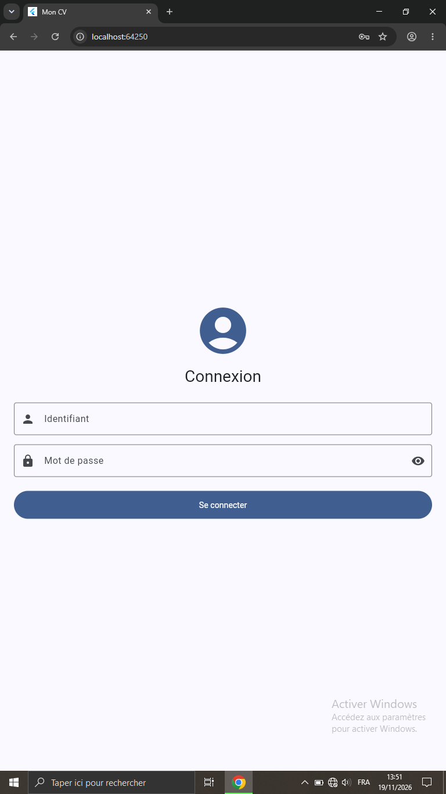
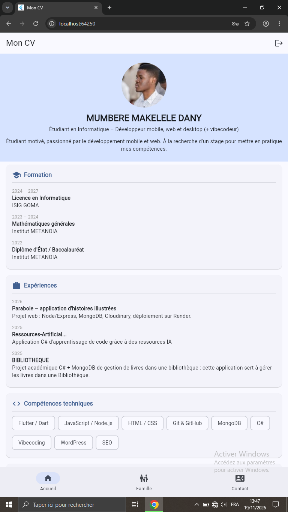
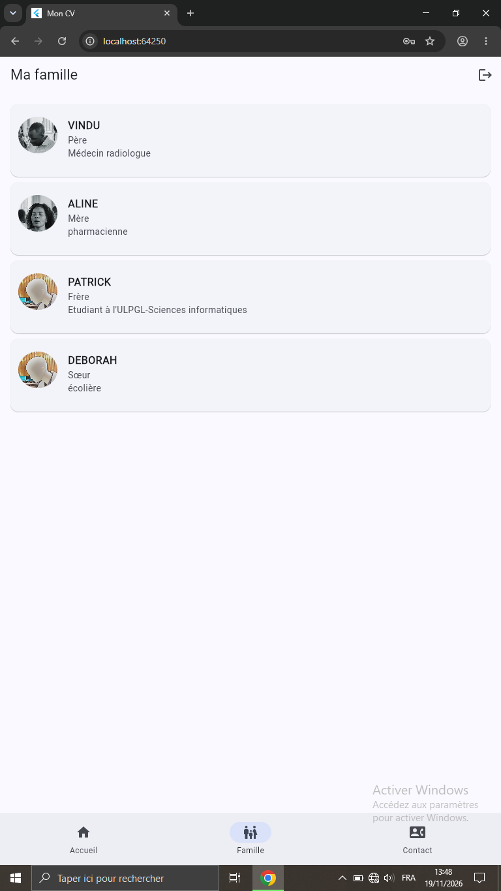

## TP2 : Intégration de l'API REST

L'application utilise désormais l'API PHP/MySQL [api-test](https://github.com/espoirbaraka/api-test) :

- **Authentification réelle** : création de compte (`POST /accounts/register`) et connexion (`POST /accounts/login`), plus aucun identifiant codé en dur.
- **Famille (CRUD)** via `/famille-membres` :
  - Lister et consulter (`GET /famille-membres`, `GET /famille-membres/{id}`)
  - Ajouter, avec photo (`POST`, multipart/form-data)
  - Modifier (`PUT` en JSON, ou `POST /famille-membres/{id}` pour changer la photo)
  - Supprimer (`DELETE`)
- Gestion des erreurs (réseau, 401, 409, 422) avec messages à l'écran, indicateurs de chargement, rafraîchissement par glissement.

### Vidéo de démonstration

▶️ **[Voir la démonstration](https://drive.google.com/file/d/1BE92jcUsYradXEOFTKKauagH1Z8z2wFn/view?usp=sharing)**

(La vidéo montre : création de compte, connexion, ajout d'un membre avec photo, consultation, modification, suppression.)

### Configuration
1. Démarrer Apache et MySQL (XAMPP), importer `api.sql` dans la base `api` (voir le README de l'API).
2. Régler l'adresse de l'API dans `lib/config.dart` (`10.0.2.2` pour l'émulateur Android, l'IP du PC pour un téléphone réel).
3. `flutter pub get` puis `flutter run`.

## Captures d'écran

| Connexion | Accueil (CV) |
|:--:|:--:|
|  |  & (screenshots/02b_accueil.png) |

| Famille | Contact |
|:--:|:--:|
|  |  |

## Technologies
Flutter, Dart, url_launcher, Material 3.
